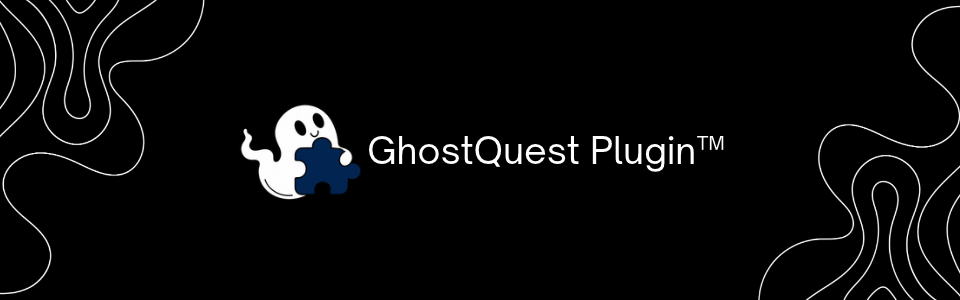

# 

# GhostQuest Plugin

Plugin de cliente do Discord desktop para listar e completar missões (quests) direto no app, sem servidor, sem proxy e sem tocar no seu token.

**Palavras-chave:** `auto quest plugin discord`, `ghostquest`, `discord quests`, `completar missões discord`, `discord plugin`, `quest completion`, `discord desktop mod`

---

## O que faz

- Lê as missões direto do store interno do cliente Discord
- Painel **GQ** dentro do Discord, com progresso por missão
- **Completar** uma missão ou **Completar todas** de uma vez
- Tipos suportados: `WATCH_VIDEO`, `WATCH_VIDEO_ON_MOBILE`, `PLAY_ON_DESKTOP`, `PLAY_ON_DESKTOP_V2`, `STREAM_ON_DESKTOP`, `PLAY_ACTIVITY` e `ACHIEVEMENT_IN_ACTIVITY`
- Spoof de jogo/stream no store de processos para os heartbeats de progresso
- Relay local (loopback) só para as conquistas de atividade em `discordsays.com`, que o CSP do renderer bloqueia

---

## O que ele NÃO faz

- Não faz hook em `fetch` / `XMLHttpRequest`
- Não lê `localStorage`, `sessionStorage` ou iframes
- Não captura, imprime ou envia o seu token
- Não usa servidor externo, proxy de credencial ou auto-update remoto
- Não resgata recompensa (o resgate tem hCaptcha — faça manual na aba Missões)

---

## Instalação (Windows)

Feche o Discord e rode:

```powershell
irm "https://ghostquest-opal.vercel.app/install-plugin.ps1" | iex
```

O instalador baixa `inject.js` e `renderer.js` para `%APPDATA%\GhostQuest`, injeta o `require` no `discord_desktop_core/index.js` (com backup `.ghostquest.bak`) e reabre o Discord. Ao abrir, aparece o botão **GQ** no canto inferior direito.

## Atualizar

```powershell
irm "https://ghostquest-opal.vercel.app/install-plugin.ps1" | iex
```

Não existe script de update separado — o mesmo instalador substitui os arquivos e reescreve o bloco injetado.

## Desinstalar

```powershell
irm "https://ghostquest-opal.vercel.app/uninstall-plugin.ps1" | iex
```

Remove o bloco injetado de todos os `index.js` e apaga `%APPDATA%\GhostQuest`.

---

## Uso

1. Abra **Descobrir → Missões** uma vez, para o store popular
2. Clique em **GQ**
3. Clique em **↻** se a lista estiver vazia
4. **Completar** na missão, ou **Completar todas**

Por tipo:

- **Vídeo** — completa no tempo real do vídeo (~7s por tick); o servidor limita o progresso ao tempo desde o `enrolled_at`
- **Jogar / Transmitir** — precisa do app desktop e do heartbeat `QUESTS_SEND_HEARTBEAT_SUCCESS`
- **Atividade** — precisa de um canal de voz ou DM aberto para simular a `call`
- **Conquista** — OAuth do app + proxy-ticket + `/.proxy/acf/quest/progress`; se o app não tiver esse backend, responde 404

---

## Limitações

- Missões bloqueadas por região podem nem aparecer — sem proxy, só vem o que o Discord entrega pra sua região
- `ACHIEVEMENT_IN_GAME` fica de fora: o progresso é reportado pelo servidor do jogo, não pelo cliente
- Missões de console (Xbox / PlayStation) precisam ser feitas no console
- Se o Discord renomear os módulos internos (`webpackChunkdiscord_app`), o painel mostra "Não encontrei os módulos internos" e um diagnóstico copiável

---

## Estrutura

```
plugin/
  inject.js      # main process: injeta o renderer + relay loopback de conquistas
  renderer.js    # UI do painel + lógica das missões (client-side)
  version.json
  README.md
  pluginbanner.png
```

Ícone e fonte (Quicksand) vão embutidos em base64 dentro do `inject.js` — o pacote de runtime é só `inject.js`, `renderer.js` e `version.json`. Os instaladores ficam em `site/`.

---

## Como fala com o Discord

O plugin usa o módulo HTTP interno do próprio cliente (`findByProps('getAPIBaseURL')`). Esse módulo anexa o header `Authorization` sozinho — o código do plugin só chama `api.get(...)` / `api.post(...)` e nunca vê o token. As requisições de conquista saem do processo principal com um token de atividade temporário, via relay em `127.0.0.1` com porta e chave aleatórias por execução, restrito a `POST authorize` / `quest/progress` do mesmo `app_id`, sem aceitar `Authorization`.

---

## Aviso

Uso por sua conta e risco. Automação de missões e modificações no cliente Discord podem violar os Termos de Serviço — desde ago/2026 contas flagradas estão sendo suspensas do acesso a quests.

---

<p align="center">
  <strong>GhostQuest</strong> — local, sem token, sem servidor.
</p>
